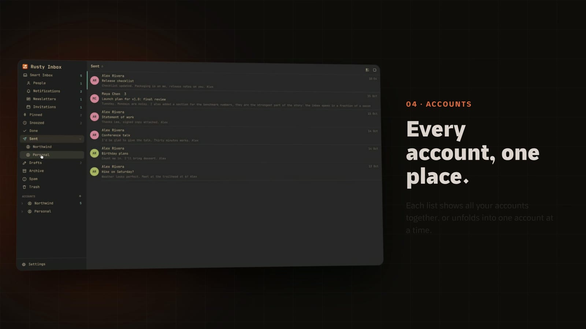
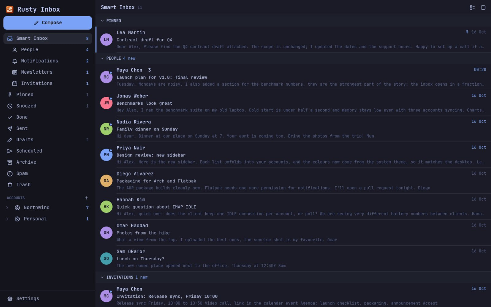
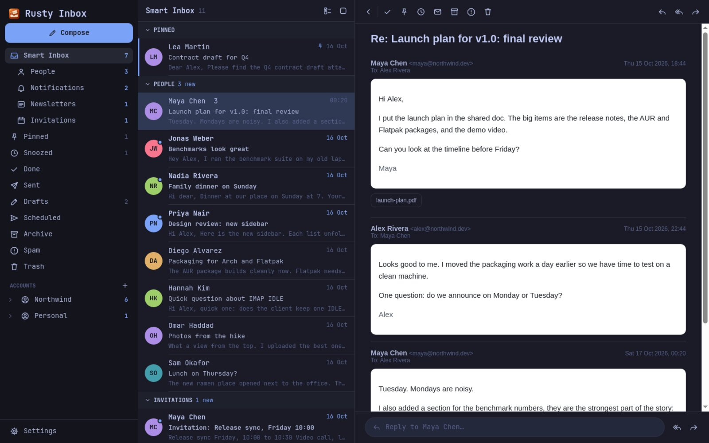
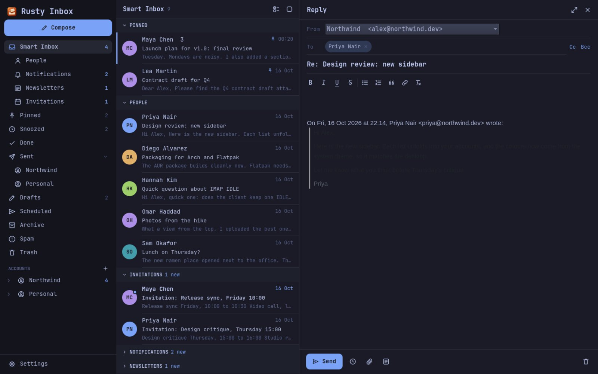
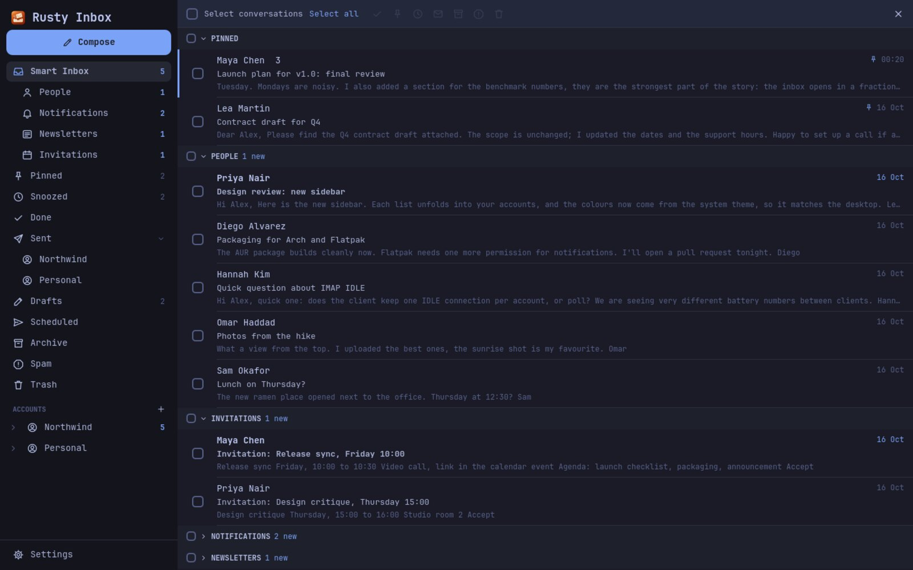
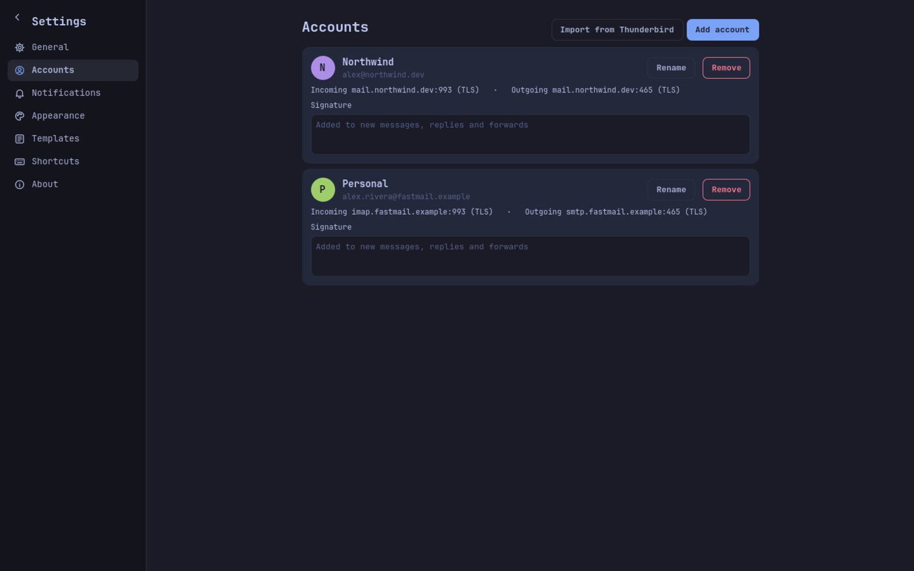
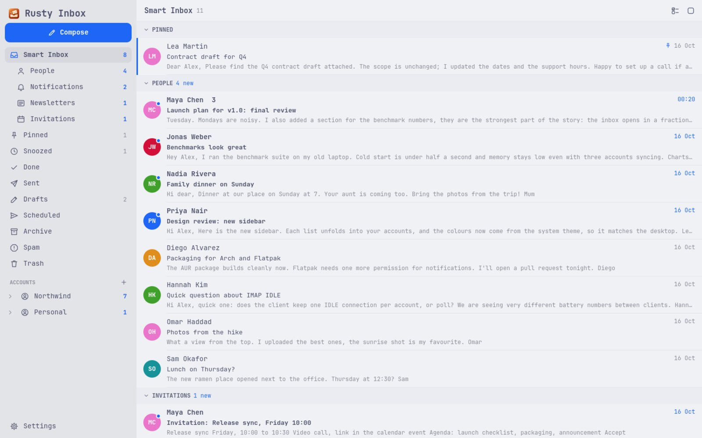
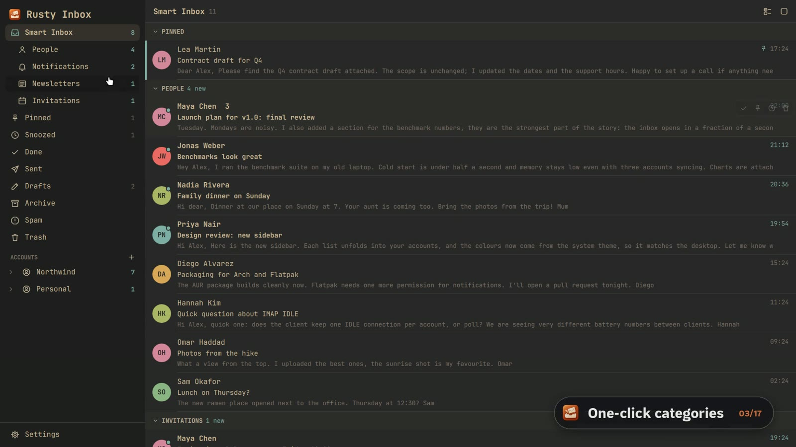

<div align="center">


# Rusty Inbox

**A fast, native email client for Linux, Windows and macOS.**
Rust mail engine · Qt 6 / QML interface · follows your desktop theme

[](https://github.com/karem505/rusty-inbox/actions/workflows/ci.yml)
[](https://github.com/karem505/rusty-inbox/releases)
[](https://aur.archlinux.org/packages/rusty-inbox)
[](#license)

[Download](#install) · [Features](#features) · [Screenshots](#screenshots) · [Build from source](#build-from-source)

</div>

Rusty Inbox is an open-source desktop mail client for IMAP and SMTP accounts: Gmail (with an app
password), Fastmail, iCloud, Yahoo, cPanel and any other standard mail server. It sorts the inbox
into people, notifications and newsletters. Every action works from the keyboard. The window
starts in a fraction of a second and stays light on memory, because the whole mail engine is
native Rust and the interface is Qt Quick, not a browser shell.

[](https://github.com/karem505/rusty-inbox/releases/download/v0.1.0/rusty-inbox-launch.mp4)

## Features

- **Smart Inbox.** Mail from people comes first. Notifications, newsletters and invitations go
  into their own groups, which you can fold away.
- **Unified mailboxes.** All accounts in one inbox, with per-account Sent, Drafts and Done when
  you need them.
- **Compose, reply, reply all, forward.** Rich-text editor, recipient chips with contact
  suggestions, attachments (picker or drag-and-drop), per-account signatures.
- **Undo Send and Send Later.** Messages wait in a local outbox, so you can take them back. A
  message that fails is retried by itself and kept under *Scheduled*, so nothing is lost.
- **Templates** for the replies you write every week.
- **Drafts sync with the server.** Drafts save while you type and appear in your mail provider's
  Drafts folder. Sent mail is filed in Sent, and replied mail is flagged as answered.
- **Done, Snooze, Pin and bulk actions** (select all or a range, then act), each with undo.
- **Keyboard first.** `J`/`K` to move, `E` Done, `S` snooze, `R` reply, `A` reply all, `F`
  forward, `C` compose, `Ctrl+Enter` send. The full list is under *Settings → Shortcuts*.
- **Desktop native.** Status-bar (tray) icon with an unread dot, desktop notifications,
  `mailto:` links, a single running instance (launching again brings the window back), and live
  theming. On [Omarchy](https://omarchy.org) the colours and font follow `omarchy theme set` as
  you switch themes.
- **Import from Thunderbird.** Accounts, servers and saved passwords come over in one click,
  provided the profile has no primary password.
- **Full HTML mail.** Each message renders in an isolated, script-free frame. Remote images
  load, and links open in your browser.
- **Local and private.** Mail is cached in SQLite on your machine. Passwords live in a local
  file readable only by you. There are no accounts, telemetry or cloud relay.

## Screenshots

| Smart Inbox | Reading |
|---|---|
|  |  |
| **Reply** | **Bulk actions** |
|  |  |
| **Accounts** | **Light theme** |
|  |  |

A full tour, recorded on a demo mailbox:

[](https://github.com/karem505/rusty-inbox/releases/download/v0.1.0/rusty-inbox-tour.mp4)

## Install

| Platform | Package |
|---|---|
| **Arch Linux** | `yay -S rusty-inbox` (builds from source) or `yay -S rusty-inbox-bin` |
| **Linux (any distro)** | Flatpak bundle or AppImage from [Releases](https://github.com/karem505/rusty-inbox/releases) |
| **Windows 10/11** | Installer (`.exe`) or portable `.zip` from [Releases](https://github.com/karem505/rusty-inbox/releases) |
| **macOS 12+** | `.dmg` (Apple Silicon and Intel) from [Releases](https://github.com/karem505/rusty-inbox/releases) |

### One-line install and update (Linux, macOS)

```sh
curl -fsSL https://raw.githubusercontent.com/karem505/rusty-inbox/main/scripts/install.sh | sh
```

The script picks the right package for your system: the AppImage, the Flatpak bundle or the
macOS app. Pass `--method appimage|flatpak|source` to choose one yourself. Run it again to
update.

Windows (PowerShell):

```powershell
irm https://raw.githubusercontent.com/karem505/rusty-inbox/main/scripts/install.ps1 | iex
```

### Adding accounts

Open *Settings → Accounts*. Most providers are detected from the address alone. For other
servers, enter the IMAP and SMTP hosts by hand. For **Gmail**, create an
[app password](https://myaccount.google.com/apppasswords) and use it as the password. Coming
from Thunderbird? Choose *Import from Thunderbird*.

From the command line:

```sh
rusty-inbox --import-thunderbird            # every Thunderbird account not added yet
rusty-inbox --add-account=account.json      # {"email": "...", "name": "...", "passwordFile": "..."}
rusty-inbox --compose                        # new message in the running window
rusty-inbox 'mailto:someone@example.org?subject=Hi'
```

## Build from source

Requirements: Rust 1.85+, Qt 6.8+ with Qt Quick, Quick Controls 2 and **Qt WebEngine**, plus a C++
compiler. The build finds Qt through `qmake6`, `qmake`, or the `QMAKE` environment variable.

```sh
# Arch:   sudo pacman -S rust qt6-declarative qt6-webengine qt6-svg
# Fedora: sudo dnf install rust cargo qt6-qtdeclarative-devel qt6-qtwebengine-devel qt6-qtsvg-devel
# Ubuntu 24.10+: sudo apt install cargo qt6-declarative-dev qt6-webengine-dev qt6-svg-dev qml6-module-qtquick-controls qml6-module-qtwebengine qml6-module-qt-labs-platform
git clone https://github.com/karem505/rusty-inbox && cd rusty-inbox
cargo build --release
./target/release/rusty-inbox
# install for your user (binary, launcher entry, icons, mailto handler):
app/packaging/install-user.sh
```

Or let the install script do it: `scripts/install.sh --method source`.

## How it is built

```
app/                      the desktop app: Qt 6 / QML through cxx-qt
  qml/                    every screen: inbox, reader, composer, settings
  src/bridge.rs           the QObject QML talks to (JSON in, signals out)
crates/rusty-inbox-core/  the mail engine, no UI
  src/mail/               IMAP sync (async-imap + rustls), SMTP (lettre), MIME parsing
  src/store.rs            SQLite cache: threads, messages, outbox, settings
  src/compose.rs          drafts, reply / forward, mailto
  src/thunderbird.rs      Thunderbird profile import (NSS key4.db decryption)
tools/demo-video/         the scripts that recorded the videos above on a fake mailbox
```

The engine runs inside the app on a small Tokio runtime. QML calls synchronous getters for
anything already stored locally, and network work reports back through Qt signals, so the
interface never waits on the network. IMAP connections are pooled per account, which keeps
servers that throttle frequent logins happy.

Tests: `cargo test --workspace`. UI smoke test, run off-screen against a copy of your data:
`QT_QPA_PLATFORM=offscreen RUSTY_INBOX_DATA_DIR=/tmp/copy target/release/rusty-inbox --autotest=/tmp/shots`.

## Privacy

Rusty Inbox talks only to the mail servers you add. It has no analytics, no crash reporting and
no servers of its own. Your mail, settings and passwords stay in your data directory:
`~/.local/share/rusty-inbox` on Linux, `~/Library/Application Support/rusty-inbox` on macOS,
`%APPDATA%\rusty-inbox` on Windows.

## Contributing

Issues and pull requests are welcome. Please run `cargo fmt`, `cargo clippy --workspace -- -D warnings`
and `cargo test --workspace` before sending a change.

## License

Licensed under either the [MIT license](LICENSE-MIT) or the [Apache License 2.0](LICENSE-APACHE),
at your option.
